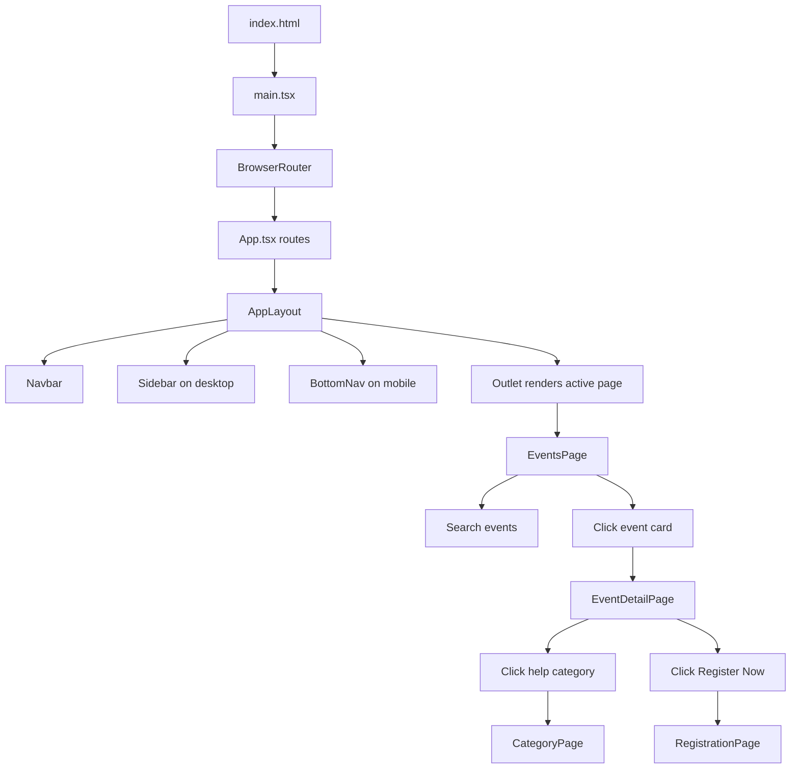

# Event Management Hub - Presentation Guide

This document explains the complete project structure file by file. Use it to prepare for your guide review and presentation.

## 1. Project Summary

Event Management Hub is currently mainly a React frontend project built with Vite, TypeScript, Tailwind CSS, React Router, and Lucide icons. It also contains an Android project scaffold generated using Gradle/Android Studio.

The main implemented workflow is:

1. User opens the Events page.
2. User searches or browses event cards.
3. User opens any event.
4. Event detail page displays quick help categories.
5. User can open Registration, Navigation, or QR Check-In category details.
6. User can click Register Now from the event detail page.
7. Registration form validates name, email, and phone.

## 2. Main Technology Stack

| Technology | Purpose |
|---|---|
| React | Builds the UI as reusable components. |
| TypeScript | Adds type safety to JavaScript code. |
| Vite | Runs and builds the frontend quickly. |
| Tailwind CSS | Provides utility classes for styling. |
| React Router DOM | Handles frontend page navigation. |
| Lucide React | Provides icons used in UI. |
| Gradle | Builds the Android module. |
| Android AppCompat/Material | Android UI dependencies for future native app development. |

## 3. Complete Frontend Flow



## 4. Root Project Files

### `.gitignore`

**Why it was created:** To tell Git which generated or local files should not be committed.

**What it contains:** Ignore rules for `.gradle`, build folders, local Android files, IDE caches, and system files.

**Where it is used:** Git automatically reads this file when checking project changes.

**Importance:** Prevents unnecessary, private, or generated files from entering the repository.

**Possible questions:**

1. Why do we need `.gitignore`?
2. Why should `build` folders not be committed?
3. What is `local.properties` and why is it ignored?

**Answers:**

1. It keeps the repository clean by ignoring generated and machine-specific files.
2. Build folders are generated automatically and can be recreated.
3. `local.properties` may contain local SDK paths, which differ from system to system.

### `settings.gradle.kts`

**Why it was created:** To configure the Gradle project and define included modules.

**What it contains:** Repository configuration, plugin management, project name, and `include(":app")`.

**Where it is used:** Gradle reads this before building the Android project.

**Importance:** Without this file, Gradle would not know that the `app` module exists.

**Possible questions:**

1. What is the purpose of `include(":app")`?
2. What are repositories like `google()` and `mavenCentral()` used for?

**Answers:**

1. It tells Gradle to include the Android app module in the build.
2. They are used to download Gradle plugins and dependencies.

### `build.gradle.kts`

**Why it was created:** To define top-level Gradle build configuration.

**What it contains:** Android application plugin alias declared with `apply false`.

**Where it is used:** Gradle uses it as the root build script.

**Importance:** It provides shared build configuration for submodules.

**Possible questions:**

1. Why is `apply false` used?
2. What is a top-level Gradle file?

**Answers:**

1. It declares the plugin version globally but applies it only inside the app module.
2. It is the common build file for the entire Gradle project.

### `gradle.properties`

**Why it was created:** To store Gradle-wide configuration.

**What it contains:** JVM memory settings and configuration cache setting.

**Where it is used:** Gradle reads this during build execution.

**Importance:** Helps improve Gradle build performance and memory usage.

**Possible questions:**

1. What does `org.gradle.jvmargs=-Xmx2048m` mean?
2. What is Gradle configuration cache?

**Answers:**

1. It gives Gradle up to 2048 MB of JVM memory.
2. It speeds up future builds by reusing previous configuration data.

### `gradlew`

**Why it was created:** Gradle wrapper script for Linux/macOS.

**What it contains:** Shell script that runs Gradle with the project-specific version.

**Where it is used:** Run `./gradlew build` on Linux/macOS.

**Importance:** Allows building without installing Gradle globally.

### `gradlew.bat`

**Why it was created:** Gradle wrapper script for Windows.

**What it contains:** Batch script that runs Gradle on Windows.

**Where it is used:** Run `gradlew.bat build` or `./gradlew.bat build` on Windows.

**Importance:** Ensures Windows users can build the Android project.

### `PRESENTATION_GUIDE.md`

**Why it was created:** To help explain the project file by file during presentation.

**What it contains:** File usage, connections, importance, and possible guide questions.

**Where it is used:** For your preparation and viva/presentation explanation.

**Importance:** Gives a complete project understanding in one document.

## 5. Gradle Folder Files

### `gradle/libs.versions.toml`

**Why it was created:** To centralize dependency and plugin versions.

**What it contains:** Versions for Android Gradle Plugin, JUnit, AppCompat, Material, Espresso, and plugin aliases.

**Where it is used:** `build.gradle.kts` and `app/build.gradle.kts` use aliases from this file.

**Importance:** Makes dependency version management easier.

**Possible questions:**

1. Why use a version catalog?
2. What does `libs.plugins.android.application` refer to?

**Answers:**

1. It keeps all dependency versions in one place.
2. It refers to the Android application plugin defined in this TOML file.

### `gradle/wrapper/gradle-wrapper.properties`

**Why it was created:** To define the Gradle wrapper version and distribution URL.

**What it contains:** Gradle distribution details.

**Where it is used:** `gradlew` and `gradlew.bat` read it.

**Importance:** Ensures all developers use the same Gradle version.

### `gradle/wrapper/gradle-wrapper.jar`

**Why it was created:** Binary file required by the Gradle wrapper.

**What it contains:** Wrapper launcher code.

**Where it is used:** Used internally when running `gradlew`.

**Importance:** Required for wrapper-based Gradle execution. Do not edit manually.

### `gradle/gradle-daemon-jvm.properties`

**Why it was created:** To configure JVM behavior for the Gradle daemon.

**What it contains:** Gradle daemon JVM settings.

**Where it is used:** Gradle uses it during Android builds.

**Importance:** Helps control build tool runtime behavior.

## 6. Frontend Root Files

### `frontend/package.json`

**Why it was created:** To define the frontend Node.js project.

**What it contains:** Project name, scripts, dependencies, and dev dependencies.

**Important scripts:**

| Script | Use |
|---|---|
| `npm run dev` | Starts development server. |
| `npm run build` | Type-checks and builds production files. |
| `npm run preview` | Previews production build locally. |

**Where it is used:** npm reads it when installing dependencies and running scripts.

**Importance:** It is the frontend project control file.

**Possible questions:**

1. What is React used for?
2. Why do we need Vite?
3. What is `lucide-react`?

**Answers:**

1. React is used to create reusable UI components.
2. Vite provides fast development and production build tooling.
3. It provides icons such as Search, Ticket, ArrowLeft, and QR Code.

### `frontend/package-lock.json`

**Why it was created:** Automatically generated by npm.

**What it contains:** Exact versions of installed dependencies.

**Where it is used:** npm uses it during `npm install`.

**Importance:** Ensures the same dependency versions are installed on all systems.

**Question:** Should we manually edit it?

**Answer:** No. npm updates it automatically.

### `frontend/index.html`

**Why it was created:** It is the browser entry HTML file for the React app.

**What it contains:** Metadata, title, root div, and module script loading `src/main.tsx`.

**Important code:**

```html
<div id="root"></div>
<script type="module" src="/src/main.tsx"></script>
```

**Where it is used:** Vite serves this file first.

**Importance:** React mounts the whole app into the `root` div.

**Possible questions:**

1. Why does HTML contain only one root div?
2. Why is script type `module`?

**Answers:**

1. React dynamically renders the whole UI inside that div.
2. Modern Vite projects use ES modules for imports and bundling.

### `frontend/vite.config.ts`

**Why it was created:** To configure Vite.

**What it contains:** React plugin, Tailwind plugin, and `@` alias.

**Where it is used:** Vite reads it when running dev server or build.

**Importance:** Enables React, Tailwind, and clean imports like `@/pages/EventsPage`.

**Possible questions:**

1. What does alias `@` mean?
2. Why are plugins needed?

**Answers:**

1. `@` points to the `src` folder.
2. Plugins add React and Tailwind support to Vite.

### `frontend/tsconfig.json`

**Why it was created:** Root TypeScript configuration.

**What it contains:** References to app and node TypeScript configs.

**Where it is used:** TypeScript uses it for project-wide checking.

**Importance:** Organizes TypeScript settings.

### `frontend/tsconfig.app.json`

**Why it was created:** TypeScript settings for React app code.

**What it contains:** JSX config, strict checking, DOM libraries, and path alias.

**Where it is used:** TypeScript checks files inside `src` using this config.

**Importance:** Catches errors and gives type safety.

**Possible questions:**

1. What does `strict: true` do?
2. What does `jsx: react-jsx` do?

**Answers:**

1. It enables strict TypeScript checks.
2. It allows React JSX syntax without importing React in every file.

### `frontend/tsconfig.node.json`

**Why it was created:** TypeScript config for tooling files like `vite.config.ts`.

**What it contains:** Node/tooling-oriented compiler settings.

**Where it is used:** TypeScript checks `vite.config.ts` using this file.

**Importance:** Separates app code settings from build tool settings.

### `frontend/.gitignore`

**Why it was created:** To ignore frontend-specific generated files.

**What it contains:** Ignore rules for dependencies/build outputs.

**Where it is used:** Git uses it inside the frontend folder.

**Importance:** Keeps frontend repository clean.

### `frontend/dev.out` and `frontend/dev.err`

**Why they exist:** They are log files from running the development server.

**What they contain:** Standard output and error output.

**Where they are used:** For debugging local dev server runs.

**Importance:** Not part of core app logic.

### `frontend/dist/`

**Why it exists:** Generated production build folder.

**What it contains:** Compiled HTML, JavaScript, and CSS assets.

**Where it is used:** Can be deployed to hosting.

**Importance:** Build output only. Do not manually edit.

### `frontend/node_modules/`

**Why it exists:** Installed npm dependencies.

**What it contains:** External library code.

**Where it is used:** Required by Vite, React, TypeScript, Tailwind, etc.

**Importance:** Needed to run locally, but not manually edited or explained file by file.

## 7. Frontend Source Entry Files

### `frontend/src/main.tsx`

**Why it was created:** It is the React entry point.

**What it contains:** Imports React, ReactDOM, BrowserRouter, App, and CSS.

**Important code:**

```tsx
createRoot(document.getElementById('root')!).render(
  <StrictMode>
    <BrowserRouter>
      <App />
    </BrowserRouter>
  </StrictMode>,
)
```

**Where it is used:** Loaded by `index.html`.

**How it connects:** It renders `App.tsx` inside `BrowserRouter`.

**Importance:** Without this file, the React app does not start.

**Possible questions:**

1. Why use `BrowserRouter`?
2. Why use `StrictMode`?

**Answers:**

1. It enables URL-based frontend routing.
2. It helps detect potential problems during development.

### `frontend/src/App.tsx`

**Why it was created:** To define all frontend routes.

**What it contains:** Route configuration for every page.

**Routes:**

| Route | Page |
|---|---|
| `/` | HomePage |
| `/events` | EventsPage |
| `/events/:eventId` | EventDetailPage |
| `/events/:eventId/category/:categoryId` | CategoryPage |
| `/events/:eventId/register` | RegistrationPage |
| `/my-events` | MyEventsPage |
| `/profile` | ProfilePage |
| `/dashboard` | DashboardPage |
| `*` | Redirects to home |

**Where it is used:** Imported by `main.tsx`.

**How it connects:** Uses `AppLayout` as a wrapper, then displays selected child route through `Outlet`.

**Importance:** It controls navigation structure for the whole app.

**Possible questions:**

1. What is `:eventId`?
2. What does `path="*"` mean?

**Answers:**

1. It is a dynamic URL parameter used to identify the selected event.
2. It catches unknown routes and redirects users to home.

### `frontend/src/index.css`

**Why it was created:** To import Tailwind CSS globally.

**What it contains:**

```css
@import "tailwindcss";
```

**Where it is used:** Imported in `main.tsx`.

**Importance:** Enables Tailwind classes used in all components.

### `frontend/src/vite-env.d.ts`

**Why it was created:** To provide Vite type definitions.

**What it contains:** Reference to `vite/client` types.

**Where it is used:** TypeScript uses it automatically.

**Importance:** Helps TypeScript understand Vite-specific imports and environment variables.

## 8. Frontend Page Files

### `frontend/src/pages/EventsPage.tsx`

**Why it was created:** To show the event discovery/listing page.

**What it contains:** Event data array, search state, filtered event list, and clickable event cards.

**Important features:**

1. Search bar.
2. Event cards.
3. Colored event icons.
4. Filtering with `useMemo`.
5. Navigation to event detail page.

**How it connects:**

1. Route `/events` in `App.tsx` loads this page.
2. Clicking an event runs `navigate(`/events/${event.slug}`)`.
3. That opens `EventDetailPage.tsx`.

**Importance:** This is the first main user-facing event workflow page.

**Possible questions:**

1. Why use `useState`?
2. Why use `useMemo`?
3. What is the `EVENTS` array?
4. How does clicking an event work?

**Answers:**

1. `useState` stores the current search text.
2. `useMemo` recalculates filtered events only when the search query changes.
3. It is temporary static event data used for the frontend prototype.
4. `useNavigate` changes the route to the selected event details URL.

### `frontend/src/pages/EventDetailPage.tsx`

**Why it was created:** To show details after opening any event.

**What it contains:** Back button, event title, event description, quick help category cards, information box, and Register Now button.

**Important features:**

1. Reads `eventId` from URL using `useParams`.
2. Converts event slug into display name.
3. Shows three quick help categories.
4. Navigates to category pages.
5. Navigates to registration page.
6. Register button is fixed near the bottom-left side.

**How it connects:**

1. Opened from `EventsPage` route `/events/:eventId`.
2. Opens `CategoryPage` route `/events/:eventId/category/:categoryId`.
3. Opens `RegistrationPage` route `/events/:eventId/register`.

**Importance:** It is the central page for actions related to a selected event.

**Possible questions:**

1. What is `useParams`?
2. How is event name displayed?
3. Why is the Register button fixed?

**Answers:**

1. It reads dynamic values from the URL.
2. `eventId` is converted from `event-1` to `EVENT 1`.
3. So users can easily register from the event detail screen.

### `frontend/src/pages/CategoryPage.tsx`

**Why it was created:** To show information for quick help categories.

**What it contains:** Back button, category title, content card, and event information box.

**Important features:**

1. Reads `eventId` and `categoryId` from URL.
2. Uses `CATEGORY_LABELS` to display clean category names.
3. Back button returns to selected event detail page.

**How it connects:** Opened from quick help cards in `EventDetailPage`.

**Importance:** Supports event help sections like Registration, Navigation, and QR Check-In.

**Possible questions:**

1. Why use `CATEGORY_LABELS`?
2. What happens for unknown category ID?

**Answers:**

1. It converts URL-friendly IDs into readable labels.
2. The code falls back to uppercase text or `CATEGORY`.

### `frontend/src/pages/RegistrationPage.tsx`

**Why it was created:** To provide event registration form UI.

**What it contains:** Name, email, phone inputs, validation, success alert, and navigation back.

**Important features:**

1. Controlled form inputs using `useState`.
2. `handleSubmit` prevents page reload.
3. Validates that all fields are filled.
4. Shows success alert and returns to event detail page.

**How it connects:** Opened from `Register Now` button in `EventDetailPage`.

**Importance:** Completes the frontend registration workflow.

**Possible questions:**

1. What are controlled inputs?
2. Is registration stored permanently?
3. Why use `preventDefault`?

**Answers:**

1. Inputs whose values are controlled by React state.
2. Not yet. This is frontend validation only; backend/database can be added later.
3. It prevents browser refresh during form submission.

### `frontend/src/pages/HomePage.tsx`

**Why it was created:** To provide a home route.

**What it contains:** `PageContainer` with title `Home` and placeholder text.

**How it connects:** Route `/` in `App.tsx`.

**Importance:** Provides default landing page and future expansion area.

**Possible question:** Why is it placeholder?

**Answer:** The current implemented workflow focuses on event discovery and registration. Home can be expanded later.

### `frontend/src/pages/MyEventsPage.tsx`

**Why it was created:** To provide a page for user’s registered/bookmarked events.

**What it contains:** Placeholder content using `PageContainer`.

**How it connects:** Route `/my-events` and nav item in `navItems.ts`.

**Importance:** Future page for displaying user’s events.

### `frontend/src/pages/ProfilePage.tsx`

**Why it was created:** To provide user profile/account page.

**What it contains:** Placeholder content using `PageContainer`.

**How it connects:** Route `/profile` and nav item in `navItems.ts`.

**Importance:** Future area for user details and settings.

### `frontend/src/pages/DashboardPage.tsx`

**Why it was created:** To provide organizer dashboard route.

**What it contains:** Placeholder content using `PageContainer`.

**How it connects:** Route `/dashboard` and nav item in `navItems.ts`.

**Importance:** Future area for organizer analytics and event management.

## 9. Frontend Layout Components

### `frontend/src/components/layout/AppLayout.tsx`

**Why it was created:** To provide one common layout for all pages.

**What it contains:** Navbar, Sidebar, main phone-like container, Outlet, and BottomNav.

**Important code:** `<Outlet />`

**How it connects:** Used as parent route wrapper in `App.tsx`.

**Importance:** Avoids repeating navigation layout in every page.

**Possible questions:**

1. What is `Outlet`?
2. Why have a layout component?

**Answers:**

1. It renders whichever child route is currently active.
2. It keeps common layout and navigation centralized.

### `frontend/src/components/layout/BottomNav.tsx`

**Why it was created:** To provide mobile bottom navigation.

**What it contains:** Floating rounded nav bar using `NavLink` and `NAV_ITEMS`.

**How it connects:** Rendered by `AppLayout`.

**Importance:** Gives mobile users quick navigation.

**Possible questions:**

1. Why use `NavLink`?
2. Why is it hidden on desktop?

**Answers:**

1. `NavLink` can detect the active route and apply active styles.
2. Desktop uses Sidebar instead.

### `frontend/src/components/layout/Navbar.tsx`

**Why it was created:** To show top branding and user/notification UI.

**What it contains:** EventHub logo, notification icon, and user initials.

**How it connects:** Rendered by `AppLayout`.

**Importance:** Provides app identity and future notification area.

### `frontend/src/components/layout/Sidebar.tsx`

**Why it was created:** To provide desktop navigation.

**What it contains:** Side menu generated from `NAV_ITEMS`.

**How it connects:** Rendered by `AppLayout` and visible on large screens.

**Importance:** Makes the app responsive for desktop.

### `frontend/src/components/layout/PageContainer.tsx`

**Why it was created:** To reuse common page spacing/title structure.

**What it contains:** Props for title, description, actions, children, and className.

**How it connects:** Used by Home, My Events, Profile, and Dashboard placeholder pages.

**Importance:** Avoids repeating the same page layout code.

**Possible questions:**

1. What are props?
2. What is `children`?

**Answers:**

1. Props are inputs passed to a React component.
2. `children` is the content placed inside a component tag.

### `frontend/src/components/layout/navItems.ts`

**Why it was created:** To store navigation items in one central place.

**What it contains:** `NAV_ITEMS` array with path, label, and icon.

**How it connects:** Used by `BottomNav` and `Sidebar`.

**Importance:** If navigation changes, we update one file and both nav components reflect it.

**Possible question:** Why separate nav data?

**Answer:** It avoids duplication and keeps navigation consistent.

## 10. Android Module Files

Important note: The Android module is currently a scaffold. It has Gradle configuration, resources, icons, themes, and tests, but no `MainActivity` is currently implemented.

### `app/build.gradle.kts`

**Why it was created:** To configure the Android app module.

**What it contains:** App namespace, SDK versions, app version, Java version, dependencies, and test dependencies.

**Where it is used:** Gradle uses it to build the Android app module.

**Importance:** Main Android module build configuration.

**Possible questions:**

1. What is `minSdk`?
2. What is `targetSdk`?
3. What are dependencies?

**Answers:**

1. Minimum Android version supported by the app.
2. Android version the app is designed for.
3. External libraries required by the Android module.

### `app/.gitignore`

**Why it was created:** To ignore app-module generated files.

**Where it is used:** Git uses it inside the Android app module.

**Importance:** Keeps module-specific build outputs out of Git.

### `app/src/main/AndroidManifest.xml`

**Why it was created:** To define Android app metadata.

**What it contains:** App icon, label, backup rules, RTL support, and theme.

**Where it is used:** Android system reads it when installing/running the app.

**Importance:** Every Android app needs a manifest.

**Important presentation note:** There is currently no Activity declared, so the native Android app is not complete yet.

### `app/src/main/res/values/strings.xml`

**Why it was created:** To store app strings.

**What it contains:** `app_name` as `Event Management Hub`.

**Where it is used:** Manifest uses `@string/app_name`.

**Importance:** Centralizes text resources.

### `app/src/main/res/values/colors.xml`

**Why it was created:** To define Android color resources.

**What it contains:** Purple, teal, black, and white color values.

**Where it is used:** Theme files use these color resources.

**Importance:** Makes Android theme colors reusable.

### `app/src/main/res/values/themes.xml`

**Why it was created:** To define light/default Android theme.

**What it contains:** MaterialComponents theme and primary/secondary colors.

**Where it is used:** Manifest references `@style/Theme.EventManagementHub`.

**Importance:** Controls native Android app appearance.

### `app/src/main/res/values-night/themes.xml`

**Why it was created:** To define dark/night theme.

**What it contains:** Color values for night mode.

**Where it is used:** Android automatically uses it in dark mode.

**Importance:** Supports dark theme behavior.

### `app/src/main/res/xml/backup_rules.xml`

**Why it was created:** To define Android backup rules.

**What it contains:** Sample backup configuration.

**Where it is used:** Manifest references it using `android:fullBackupContent`.

**Importance:** Controls app data backup behavior.

### `app/src/main/res/xml/data_extraction_rules.xml`

**Why it was created:** To define Android 12+ data extraction and backup rules.

**What it contains:** Sample cloud backup/device transfer structure.

**Where it is used:** Manifest references it using `android:dataExtractionRules`.

**Importance:** Required for modern Android backup behavior.

### `app/src/main/keepRules/rules.keep`

**Why it was created:** To store R8 keep rules.

**What it contains:** Comments and sample rules.

**Where it is used:** Android build tools combine it during release optimization.

**Importance:** Future place to protect classes from being removed or obfuscated.

### `app/src/main/res/drawable/ic_launcher_background.xml`

**Why it was created:** Launcher icon background resource.

**Where it is used:** Adaptive launcher icon files.

**Importance:** Part of Android app icon.

### `app/src/main/res/drawable/ic_launcher_foreground.xml`

**Why it was created:** Launcher icon foreground resource.

**Where it is used:** Adaptive launcher icon files.

**Importance:** Part of Android app icon.

### `app/src/main/res/mipmap-*/*.webp`

**Why they were created:** Launcher icon images for different screen densities.

**What they contain:** App icons and round app icons.

**Where they are used:** Manifest references `@mipmap/ic_launcher` and `@mipmap/ic_launcher_round`.

**Importance:** Android selects the correct icon size for each device.

### `app/src/main/res/mipmap-anydpi-v26/ic_launcher.xml`

**Why it was created:** Adaptive launcher icon for Android 8+.

**Where it is used:** Android launcher uses it for adaptive icon shapes.

**Importance:** Modern Android icon support.

### `app/src/main/res/mipmap-anydpi-v26/ic_launcher_round.xml`

**Why it was created:** Adaptive round launcher icon.

**Where it is used:** Android launchers that support round icons.

**Importance:** Provides round icon support.

### `app/src/test/java/com/example/eventmanagementhub/ExampleUnitTest.java`

**Why it was created:** Default local unit test file.

**What it contains:** Test that checks `2 + 2 = 4`.

**Where it is used:** Runs on local JVM with JUnit.

**Importance:** Placeholder for future unit tests.

### `app/src/androidTest/java/com/example/eventmanagementhub/ExampleInstrumentedTest.java`

**Why it was created:** Default Android instrumented test.

**What it contains:** Test that checks app package name.

**Where it is used:** Runs on Android device/emulator.

**Importance:** Placeholder for future UI/device tests.

## 11. IDE Files

### `.idea/`

**Why it exists:** Created by Android Studio or IntelliJ IDEA.

**What it contains:** IDE settings such as Gradle sync, compiler config, run configurations, and VCS settings.

**Where it is used:** Used by the IDE, not by app runtime.

**Importance:** Helps the IDE open and configure the project.

**Presentation note:** You do not need to explain every `.idea` file in detail unless asked. They are environment/project metadata.

## 12. Most Important Files to Explain First

If time is short, explain these files first:

1. `frontend/src/main.tsx`
2. `frontend/src/App.tsx`
3. `frontend/src/components/layout/AppLayout.tsx`
4. `frontend/src/pages/EventsPage.tsx`
5. `frontend/src/pages/EventDetailPage.tsx`
6. `frontend/src/pages/CategoryPage.tsx`
7. `frontend/src/pages/RegistrationPage.tsx`
8. `frontend/src/components/layout/BottomNav.tsx`
9. `frontend/src/components/layout/navItems.ts`
10. `frontend/package.json`

## 13. Common Presentation Questions and Answers

### What is the main working part of this project?

The main working part is the React frontend inside the `frontend` folder.

### How does the app start?

`index.html` loads `src/main.tsx`. `main.tsx` renders `App.tsx` inside the `root` div.

### Where are all pages connected?

All pages are connected in `App.tsx` using React Router routes.

### How does event navigation work?

In `EventsPage.tsx`, clicking an event calls `navigate('/events/event-1')`. Then `App.tsx` matches `events/:eventId` and opens `EventDetailPage.tsx`.

### How does the detail page know which event was selected?

It uses `useParams()` to read `eventId` from the URL.

### Is the registration connected to a database?

No. Currently it is frontend-only validation. Backend/database integration can be added later.

### What is Tailwind CSS used for?

Tailwind is used to style components directly through utility classes like `bg-gradient-to-br`, `rounded-[22px]`, and `text-white`.

### What is Lucide React used for?

It provides icons like Search, Ticket, ArrowLeft, QR Code, MapPin, and Dashboard icons.

### Why do we have `BottomNav` and `Sidebar`?

`BottomNav` is for mobile screens and `Sidebar` is for desktop screens.

### What is the Android folder used for?

It is currently an Android project scaffold. It has Gradle setup, resources, themes, icons, and tests, but no native activity yet.

## 14. Final Presentation Script

You can say:

"Our Event Management Hub project currently focuses on a React frontend. The app starts from `index.html`, where the root div is loaded. Then `main.tsx` renders the React application and wraps it with `BrowserRouter` for routing. `App.tsx` defines all routes such as Events, Event Details, Category Page, and Registration Page. All pages are wrapped inside `AppLayout`, which contains the navbar, sidebar, bottom navigation, and the page outlet.

The main user flow starts from the Events page. `EventsPage.tsx` displays event cards and includes search functionality. When a user clicks an event, React Router navigates to `EventDetailPage.tsx`, where the selected event name is shown using the route parameter. This page also contains quick help categories and a fixed Register Now button at the bottom-left side.

If the user clicks a help category, `CategoryPage.tsx` opens and displays category-specific information. If the user clicks Register Now, `RegistrationPage.tsx` opens a form for name, email, and phone number. The form validates that all fields are filled, then shows a success alert and returns to the event detail page.

The design uses Tailwind CSS for styling, Lucide React for icons, and React Router for navigation. The Android module is currently a scaffold with Gradle settings, resources, themes, and tests, but the implemented working UI is in the frontend folder."

## 15. Current Limitations

| Limitation | Explanation |
|---|---|
| Events are hardcoded | The `EVENTS` array is inside `EventsPage.tsx`. |
| No backend yet | Registration is not saved to a database. |
| No authentication yet | Any user can access the registration form. |
| Placeholder pages exist | Home, My Events, Profile, and Dashboard are not fully implemented yet. |
| Android native app incomplete | No `MainActivity` currently exists. |

## 16. Future Improvements

1. Connect events to backend API/database.
2. Save registration data permanently.
3. Add authentication/login.
4. Show registered events in My Events page.
5. Build organizer dashboard analytics.
6. Add native Android activity or convert frontend into mobile app wrapper.
7. Replace alerts with proper success/error UI components.
