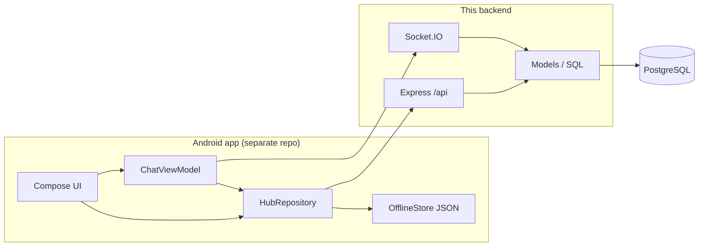
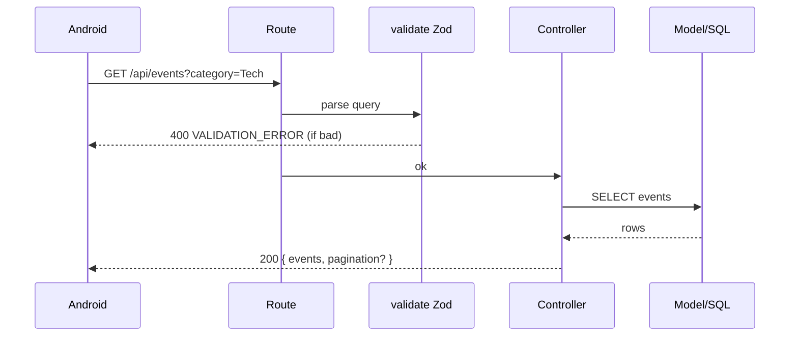
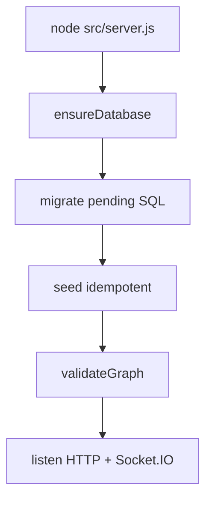
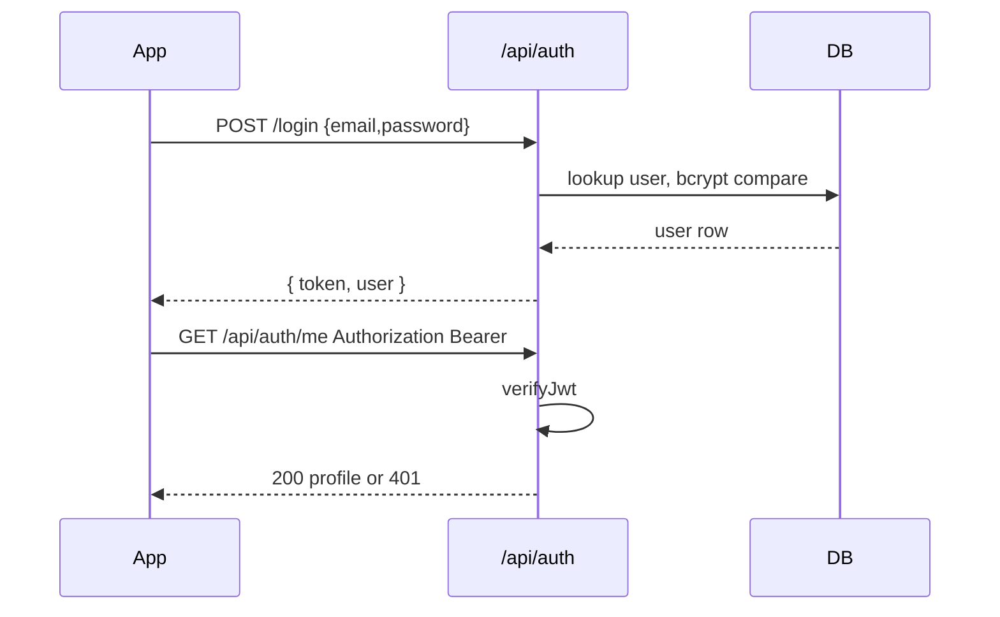
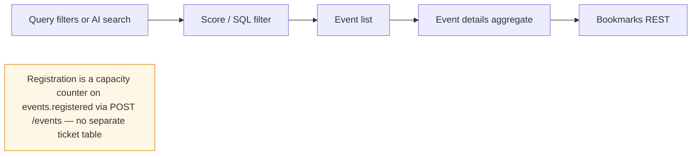
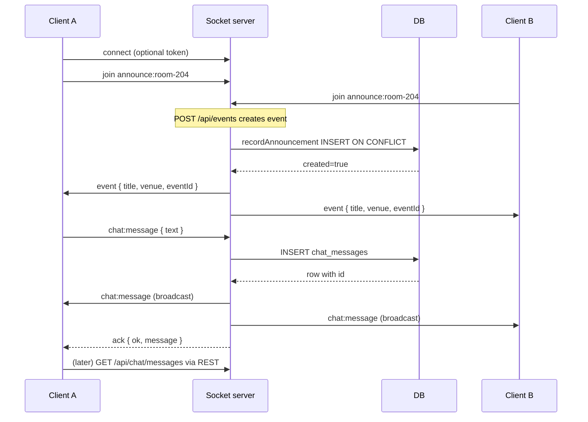
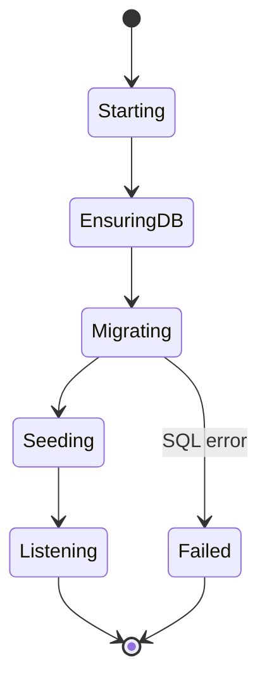

# Project Flow Diagrams

Mermaid diagrams for flows **implemented in this codebase**. Incomplete or
external pieces are labelled.

## 1. Overall system architecture

## 2. API request / response flow

## 3. Database interaction (boot)

## 4. Authentication flow

Socket path: optional `auth.token` → `resolveHandshakeAuth` → invalid ⇒
`connect_error AUTH_INVALID_TOKEN`.

## 5. Event discovery and registration

## 6. Real-time announcements and chat

## 7. Application startup and database initialization

---

Diagrams cover implemented paths only. Push notifications, payments, and
multi-instance Socket.IO are **not** in this system.
